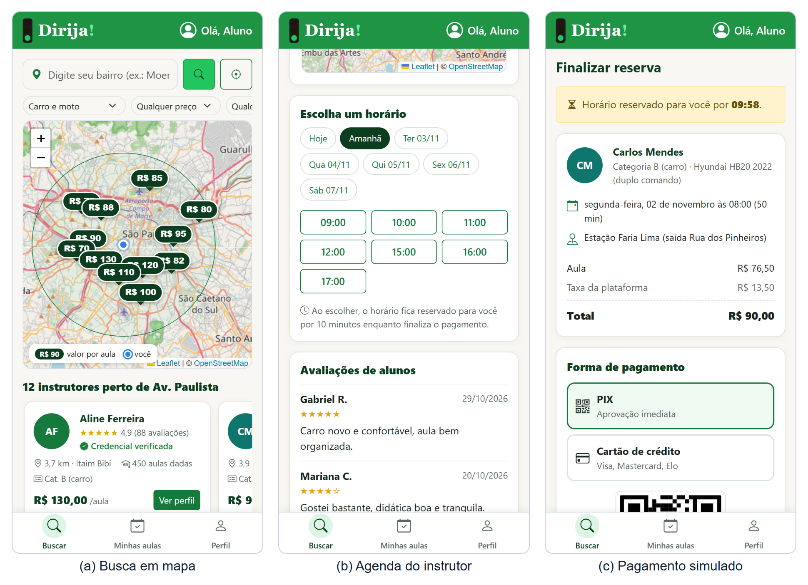
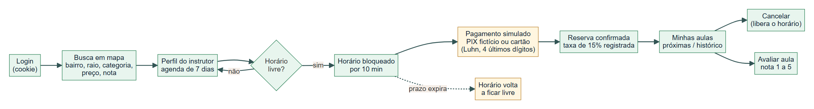
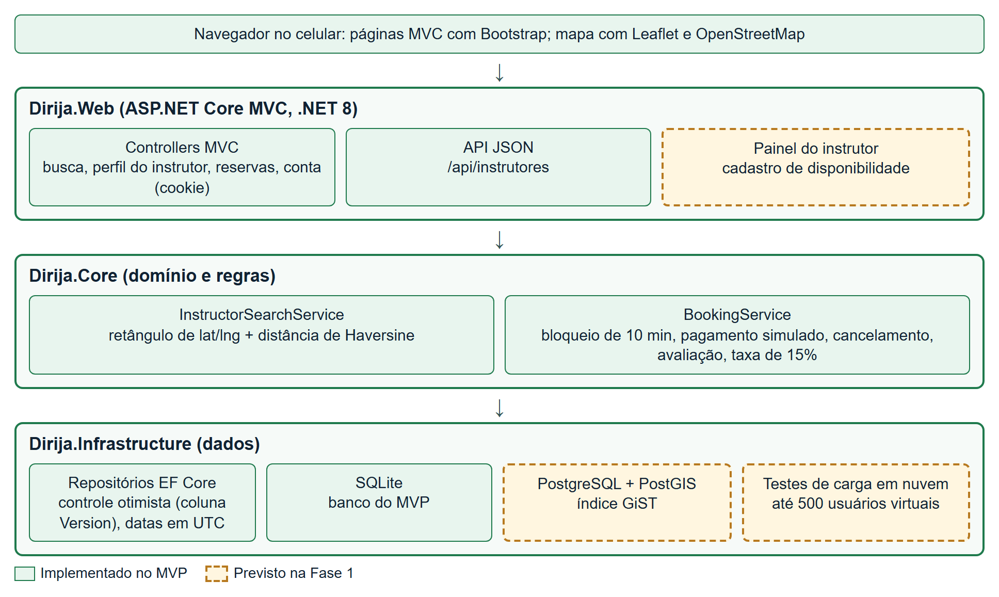
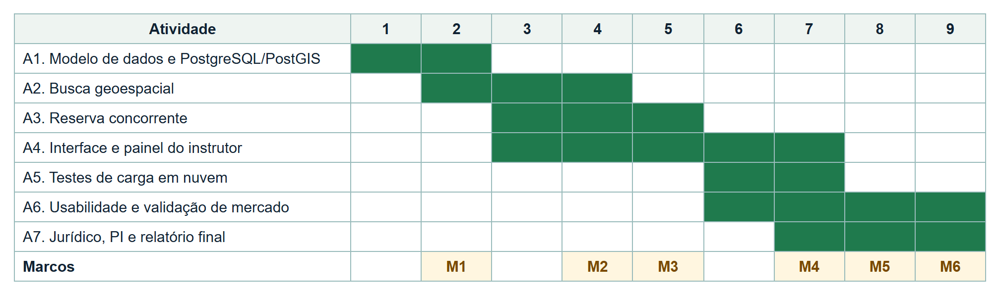

**Projeto de Pesquisa para Inovação**

| 1 \- Título |
| :---- |

Busca geoespacial e reserva concorrente de aulas práticas de direção com instrutores autônomos: prova de conceito da plataforma Dirija!

| 2 \- Resumo |
| :---- |

A Resolução CONTRAN nº 1.020, de 1º de dezembro de 2025, acabou com a obrigatoriedade das aulas práticas em autoescola, reduziu a carga prática mínima para duas horas-aula e permitiu que essas aulas sejam dadas por instrutores autônomos credenciados. O governo federal informa que 5,4 milhões de pessoas iniciaram a primeira habilitação pela plataforma CNH do Brasil desde dezembro de 2025 e que 211 mil pessoas se inscreveram no curso de formação de instrutores. O aplicativo oficial já permite localizar instrutores e falar com eles por WhatsApp, mas a marcação do horário e o pagamento são combinados diretamente entre aluno e instrutor.

A Dirija Tecnologia Ltda. (empresa a constituir) propõe estudar dois problemas técnicos dessa intermediação. O primeiro é a busca por proximidade: listar, com baixa latência, os instrutores cuja área de atendimento cobre o endereço do aluno, aplicando filtros de categoria, preço e nota. O segundo é a reserva concorrente: impedir que dois alunos reservem o mesmo horário de um instrutor, mesmo quando as tentativas chegam ao mesmo tempo, sem bloquear o sistema para os demais usuários.

A equipe já construiu um produto mínimo viável (MVP) em ASP.NET Core 8 com banco SQLite. O MVP cobre o fluxo do aluno: busca em mapa, perfil do instrutor com agenda, bloqueio do horário por 10 minutos, pagamento simulado, cancelamento e avaliação. Há 63 testes automatizados aprovados, entre eles um teste em que 50 alunos tentam reservar o mesmo horário ao mesmo tempo e apenas um consegue. A Fase 1 vai levar essas soluções para PostgreSQL/PostGIS, comparar estratégias de indexação espacial e de controle de concorrência sob carga, criar um painel mínimo para o instrutor cadastrar a disponibilidade e avaliar a usabilidade com alunos e instrutores reais.

As metas são: tempo de resposta da busca no percentil 95 abaixo de 300 ms com 10 mil instrutores cadastrados, nenhuma reserva duplicada nos testes de carga, pelo menos 80% de sucesso nas tarefas de busca e reserva e nota média de pelo menos 70 no questionário SUS. O projeto também vai testar com instrutores a aceitação da taxa de 15% por aula.

O projeto dura 9 meses e solicita R$ 31.850,00 para serviços de nuvem, testes de carga, consultoria jurídica, avaliação independente de usabilidade, smartphones de teste e linhas de dados. Não há bolsas. A empresa oferece como contrapartida 2.496 horas de trabalho dos cinco sócios, estudantes de Sistemas de Informação da USP. O resultado esperado é uma prova de conceito medida e documentada, que indique se a solução é viável tecnicamente e se há interesse do mercado antes de uma Fase 2.

| 3 \- Objetivos  |
| :---- |

**Objetivo geral.** Verificar, com experimentos e medições, se uma plataforma web pode localizar instrutores autônomos próximos ao aluno e reservar horários sem conflito, com desempenho e usabilidade adequados ao uso em celular, partindo do MVP já existente.

**Objetivos específicos.** Cada objetivo está ligado a uma incerteza técnica ou de mercado, a um experimento e a uma meta mensurável (Tabela 1).

1. **Busca por proximidade.** Comparar a estratégia atual do MVP (pré-filtro por retângulo de latitude e longitude no banco, seguido do cálculo exato da distância pela fórmula de Haversine) com as consultas espaciais do PostGIS com índice GiST (`ST_DWithin` e ordenação por vizinho mais próximo). A comparação usará bases sintéticas de 1 mil, 10 mil e 100 mil instrutores e medirá latência e exatidão do resultado.
2. **Reserva sem conflito.** Comparar três estratégias para garantir que um horário tenha no máximo uma reserva ativa: controle otimista por versão (já usado no MVP), bloqueio pessimista (`SELECT ... FOR UPDATE`) e restrição de exclusão sobre intervalos de tempo no PostgreSQL. A comparação será feita sob carga, com muitos alunos disputando os mesmos horários.
3. **Disponibilidade do instrutor.** Construir um painel mínimo em que o instrutor cadastre e bloqueie horários. É a parte que falta para que a agenda do MVP deixe de usar dados de exemplo.
4. **Usabilidade.** Medir, com alunos e instrutores, a taxa de sucesso nas tarefas principais e a nota SUS, corrigindo os problemas encontrados entre as rodadas de teste.
5. **Interesse do mercado.** Entrevistar instrutores credenciados e alunos para testar as premissas do modelo de negócio: taxa de 15% por aula, preço médio da aula e número de aulas por aluno.

| Objetivo | Indicador | Situação no MVP | Meta da Fase 1 |
| :---- | :---- | :---- | :---- |
| 1 | Latência da busca, percentil 95 (p95), 10 mil instrutores, 50 usuários simultâneos | Não medida (13 instrutores de exemplo) | p95 < 300 ms |
| 1 | Exatidão: instrutores dentro do raio que deixam de aparecer, e instrutores fora do raio que aparecem | Coberta por testes unitários com dados de exemplo | 0 omissões e 0 inclusões indevidas; diferença de distância ≤ 0,5% em relação ao cálculo geodésico do PostGIS |
| 2 | Reservas duplicadas para o mesmo horário | 0 em 50 tentativas simultâneas (SQLite) | 0 em todos os testes de carga com até 500 usuários virtuais (PostgreSQL) |
| 2 | Vazão e latência p95 da reserva sob disputa | Não medidas | Relatório comparativo das três estratégias |
| 3 | Instrutor consegue publicar sua agenda sem ajuda | Não existe (agenda gerada por dados de exemplo) | ≥ 80% dos instrutores testados |
| 4 | Sucesso nas tarefas de busca e reserva, sem ajuda | Protótipo de telas avaliado por 6 alunos | ≥ 80% |
| 4 | Nota SUS média (0 a 100) | Não aplicada | ≥ 70 |
| 5 | Instrutores que aceitam a taxa de 15% | Não testado | Resultado registrado; a premissa é revista se menos da metade aceitar |

Tabela 1 — Objetivos específicos, indicadores e metas. O MVP serve como linha de base.

**Resultados de inovação almejados.** Para o aluno, o resultado é encontrar um instrutor credenciado perto de casa, ver preço e horários livres e reservar sem negociar pelo telefone. Para o instrutor, é ter a agenda publicada e protegida contra marcações duplicadas. Para a empresa, é saber, com dados, se a arquitetura aguenta a carga prevista e se instrutores e alunos aceitam o modelo de cobrança, antes de investir em pagamento real e verificação documental, que ficam para uma eventual Fase 2.

| 4 \- Revisão da Evolução Científico-Tecnológica Relacionada ao projeto |
| :---- |

**Contexto regulatório.** Até 2025, a formação prática de condutores no Brasil passava obrigatoriamente pelos Centros de Formação de Condutores (CFCs), conforme a Resolução CONTRAN nº 789/2020. Ferreira (2015) descreve o instrutor como figura central desse processo e mostra que a formação tende a se concentrar na preparação para o exame. A Resolução CONTRAN nº 1.020/2025 mudou esse quadro: a carga prática mínima passou a ser de duas horas-aula, que podem ser dadas por instrutor autônomo credenciado. O governo federal lançou em maio de 2026 a "Nova Jornada do Instrutor" no aplicativo CNH do Brasil, que permite buscar instrutores e autoescolas por localização (BRASIL, 2026a). A mudança ainda é contestada: a Confederação Nacional do Comércio (CNC) ajuizou no STF a ADI 7978 contra trechos da resolução (STF, 2026). O mercado existe, mas a regra que o criou pode ser alterada.

**Plataformas de dois lados.** Um marketplace de aulas atende dois grupos que dependem um do outro: alunos e instrutores. Rochet e Tirole (2003) mostram que, nesse tipo de mercado, a estrutura de preços entre os dois lados determina a adesão, e que a plataforma precisa atrair ambos ao mesmo tempo. Parker, Van Alstyne e Choudary (2016) descrevem como plataformas reduzem custos de busca e de transação e por que a confiança (avaliações, verificação de identidade) é condição para que estranhos façam negócio. No caso da Dirija!, o custo de transação que se quer reduzir é a marcação do horário: hoje o aluno encontra o instrutor, mas combina data, hora e pagamento por mensagem.

**Busca espacial.** A busca "instrutores que atendem este endereço" é uma consulta por raio. Sem índice, o banco precisa calcular a distância até todos os instrutores. Guttman (1984) propôs a R-tree, índice que agrupa objetos por retângulos envolventes e permite descartar regiões inteiras. O PostGIS implementa esse tipo de índice sobre a estrutura GiST do PostgreSQL e oferece funções como `ST_DWithin` (todos os pontos a até *d* metros) e o operador `<->` (vizinho mais próximo) (OBE; HSU, 2021). O MVP usa uma versão simples da mesma ideia: um índice comum sobre latitude e longitude, uma consulta pelo retângulo que contém o círculo de busca e o cálculo exato da distância em memória. Falta saber a partir de quantos instrutores essa abordagem deixa de atender à meta de latência e quanto o PostGIS melhora o resultado.

**Controle de concorrência.** Duas reservas simultâneas do mesmo horário formam o problema clássico de atualização concorrente. Kung e Robinson (1981) propuseram o controle otimista: as transações trabalham sem bloqueio e, ao gravar, verificam se o dado mudou; se mudou, uma delas é rejeitada. Gray e Reuter (1992) e Bernstein e Newcomer (2009) tratam das alternativas pessimistas, com bloqueio do registro antes da alteração. Berenson et al. (1995) mostram que os níveis de isolamento do padrão SQL não impedem, sozinhos, todas as anomalias, o que obriga a verificar na prática o comportamento de cada estratégia. O controle otimista tende a funcionar bem com pouca disputa e a gerar muitas rejeições com muita disputa, como no horário mais procurado de um instrutor bem avaliado. Esse comportamento ainda não foi medido para o padrão de uso da plataforma.

**Usabilidade.** Nielsen (1993) define usabilidade por aprendizado, eficiência, memorização, erros e satisfação, e propõe a avaliação heurística por especialistas. Brooke (1996) criou o questionário SUS, de dez itens e nota de 0 a 100. Bangor, Kortum e Miller (2008) analisaram cerca de 2.300 aplicações do questionário e encontraram média próxima de 70, valor usado aqui como meta. A Tabela 2 resume como cada trabalho é usado no projeto.

| Referência | Contribuição | Uso no projeto |
| :---- | :---- | :---- |
| CONTRAN (2020; 2025) | Regras de formação de condutores, antes e depois da abertura aos autônomos | Justificativa do mercado e risco regulatório |
| Ferreira (2015) | Papel do instrutor na formação de condutores | Contexto do problema |
| Rochet e Tirole (2003); Parker et al. (2016) | Teoria de mercados de dois lados e de plataformas | Modelo de negócio e estratégia de entrada (seção 7) |
| Guttman (1984); Obe e Hsu (2021) | R-tree; consultas espaciais no PostGIS | Experimento A2 |
| Kung e Robinson (1981); Gray e Reuter (1992); Bernstein e Newcomer (2009); Berenson et al. (1995) | Controle otimista e pessimista; níveis de isolamento | Experimento A3 |
| Nielsen (1993); Brooke (1996); Bangor et al. (2008) | Avaliação heurística; questionário SUS e valores de referência | Experimento A6 e metas da Tabela 1 |
| Schwaber e Sutherland (2020) | Scrum | Gestão do projeto (seção 6b) |

Tabela 2 — Trabalhos relacionados e seu uso no projeto.

**Resultados preliminares da equipe.** Antes desta proposta, a equipe fez duas etapas de trabalho.

A primeira foi um teste de protótipo de telas com 6 respondentes, todos estudantes, com idades entre 20 e 34 anos. Os respondentes não entenderam os números exibidos no mapa nem os ícones da barra inferior. Pediram marcadores com o instrutor no mapa e cartões horizontais com número de avaliações, aulas dadas, distância e bairro. Também sentiram falta de histórico, configurações, pagamento e opção de sair no perfil. As opiniões se dividiram entre mostrar a agenda ou as próximas aulas na tela inicial. Esses pontos foram tratados no MVP (Tabela 3).

| Achado do teste de protótipo | Como o MVP tratou |
| :---- | :---- |
| Números no mapa e ícones da barra inferior pouco claros | Um marcador por instrutor, com o preço da aula, ligado ao cartão correspondente; barra inferior com ícone e texto (Buscar, Minhas aulas, Perfil) |
| Pedido de cartões horizontais com mais informação | Cartão com nota, número de avaliações, aulas dadas, distância e bairro |
| Falta de histórico, configurações, pagamento e sair no perfil | Perfil com histórico, métodos de pagamento, preferências e botão Sair (as preferências de notificação são apenas visuais) |
| Opiniões divididas entre agenda e próximas aulas | Tela "Minhas aulas" com abas "Próximas" e "Histórico" |

Tabela 3 — Achados do teste de protótipo (6 respondentes) e mudanças feitas no MVP.

A segunda foi o próprio MVP (Figura 1 e Figura 2), com dados fictícios de 13 instrutores em bairros de São Paulo, dos quais 12 aparecem como verificados. O sistema tem busca em mapa (Leaflet com OpenStreetMap) com filtros de bairro, raio, categoria, preço e nota, e lista apenas instrutores marcados como verificados. O perfil do instrutor mostra a agenda dos próximos 7 dias. Ao escolher um horário, o sistema o bloqueia por 10 minutos enquanto o aluno paga. O pagamento é simulado: o PIX é fictício e o cartão passa apenas pela verificação de Luhn, com apenas os 4 últimos dígitos guardados. A taxa de 15% é calculada e registrada em cada reserva. O aluno pode cancelar, o que libera o horário, e avaliar a aula concluída com nota de 1 a 5.

Os dados ficam em SQLite com Entity Framework Core. Cada horário tem uma coluna de versão usada no controle otimista. As senhas são guardadas com hash PBKDF2 e as datas em UTC. Os 63 testes automatizados (unitários e de integração) passam. Um deles cria um banco SQLite em arquivo, dispara 50 tentativas simultâneas de reserva do mesmo horário e confirma que apenas uma é aceita. O MVP não tem painel do instrutor, cadastro de novos usuários, pagamento real nem consulta automática de credenciais. A marcação de "verificado" é um campo dos dados de exemplo.

Figura 1 — Telas do MVP em celular (390 × 844 px): (a) busca em mapa, com um marcador de preço por instrutor; (b) agenda do instrutor, com os horários livres; (c) pagamento simulado, com o horário bloqueado por 10 minutos e a taxa de 15% discriminada. Dados fictícios.

Figura 2 — Fluxo do aluno implementado no MVP. O horário fica bloqueado por 10 minutos entre a escolha e o pagamento; se o prazo expirar, volta a ficar livre.

**Grupos de pesquisa.** No Brasil, o tema de bancos de dados espaciais é estudado por grupos de geoinformática como o do INPE, desenvolvedor da biblioteca TerraLib, e o controle de concorrência é tema de grupos de bancos de dados das universidades paulistas, inclusive da USP. A equipe pretende buscar a orientação de docentes da própria universidade para os experimentos A2 e A3.

| 5 \- Competidores, Propriedade Intelectual e Liberdade de Operação |
| :---- |

**Competidores.** A Tabela 4 resume as soluções encontradas. O concorrente mais importante é o próprio aplicativo oficial CNH do Brasil, gratuito e com cadastro dos instrutores feito pelo governo. Nas fontes consultadas, ele oferece busca por localização, avaliações, contato por WhatsApp e credencial digital do instrutor, mas não oferece reserva de horário nem pagamento. A Dirija! não compete com o aplicativo oficial na descoberta do instrutor. A proposta é cuidar da etapa seguinte: agenda publicada, reserva sem conflito, pagamento e histórico das aulas.

| Solução | Tipo | O que oferece (segundo a fonte) | Diferença em relação à Dirija! |
| :---- | :---- | :---- | :---- |
| App CNH do Brasil (Senatran) | Oficial, gratuito | Busca por localização, avaliações, WhatsApp, credencial digital | Sem reserva de horário nem pagamento no app |
| Autoescolas (CFCs) | Tradicional | Pacotes de aulas e estrutura própria | Preço em pacote; podem continuar dando as aulas obrigatórias |
| CNH Prime | App nacional | Escolha de instrutores credenciados próximos e agendamento | Concorrente direto; o funcionamento não foi testado pela equipe |
| instrutorautonomo.com | Diretório nacional | Lista de instrutores autônomos certificados | Sem agenda nem pagamento |
| GetNinjas | Marketplace genérico | Contratação de prestadores de vários serviços | Sem agenda por horário nem foco na habilitação |
| Calendly | Agenda genérica | Agendamento de compromissos | Sem busca de prestadores |
| EzLicence | Marketplace (Reino Unido/Austrália) | Comparação de instrutores por região, preço, avaliações e disponibilidade | Modelo próximo, fora do Brasil |
| DriveInstruct | Software (Reino Unido) | Agenda do instrutor e busca por região | Fora do Brasil |

Tabela 4 — Soluções concorrentes. Informações retiradas dos sites e de notícias oficiais em 01/11/2026, sem teste de uso.

A existência do CNH Prime e do EzLicence mostra que a ideia de reservar aulas com instrutores não é nova. O que o projeto pretende demonstrar é uma execução medida: reserva sem duplicidade sob carga, busca rápida e usabilidade validada com o público de São Paulo. Os riscos competitivos são o governo acrescentar agendamento ao aplicativo oficial e um concorrente com mais capital ocupar o mercado antes. O risco regulatório é a ADI 7978, que pode restringir a atuação dos autônomos. Por isso a Fase 1 tem custo baixo e termina com uma decisão de continuar ou não, baseada nos indicadores da Tabela 1.

**Propriedade intelectual.** A busca preliminar foi feita no Google Patents em 01/11/2026, com quatro combinações de termos (Tabela 5).

| Busca | Termos | Escopo | Resultados | Documentos mais próximos |
| :---- | :---- | :---- | :---- | :---- |
| 1 | ("driving instructor") (booking OR scheduling) (location OR geolocation) | Mundial | 104 | CA3179758A1 (app que conecta aluno e instrutor; ativo no Canadá, sem família no Brasil); JP2024009466A (gestão de autoescola; só Japão); US20260220571A1 (instrução de direção em carona; só EUA) |
| 2 | ("driving lesson") (booking OR reservation) (instructor) (learner OR student) | Mundial | 27 | WO2011126379A1 (registro de aulas; não ativo); JP7880574B2 (autoescola online; só Japão) |
| 3 | (instrutor) (aula OR aulas) (agendamento OR reserva) | Brasil | 4 | Nenhum sobre instrução de trânsito |
| 4 | ("double booking") (prevent OR prevention) ("time slot") (concurrent OR concurrency) | Mundial | 34 | US20240221041A1 (alerta de conflito em calendário; só EUA) |

Tabela 5 — Busca preliminar de patentes (Google Patents, 01/11/2026).

**Liberdade de operação.** Não foram identificadas patentes impeditivas com efeito no Brasil na busca realizada em 01/11/2026. Os documentos mais próximos são estrangeiros e não têm família no Brasil, e uma patente só vale no território onde foi concedida. Além disso, a Lei nº 9.279/1996, art. 10, não considera invenção os métodos comerciais nem os programas de computador em si. As técnicas usadas no projeto (índices R-tree/GiST, controle otimista e pessimista) são descritas na literatura há décadas e estão implementadas em software livre (PostgreSQL, PostGIS). Esta é uma busca preliminar, não um parecer de liberdade de operação. A busca na base do INPI, nas classes G06Q 10/02 (reservas) e G09B 19/16 (ensino de condução de veículos), será feita na atividade A7, e o resultado será incluído no relatório da Fase 1.

**Proteção pretendida.** A empresa vai pedir o registro da marca "Dirija!" no INPI, depois de pesquisa de anterioridade nas classes 9, 35, 41 e 42, e o registro do programa de computador. O código-fonte é protegido por direito autoral, e o conhecimento obtido nos experimentos (parâmetros de índice, estratégia de reserva escolhida) será mantido como segredo de negócio.

| 6 \- Plano de Pesquisa |
| :---- |

**a) Resultados obtidos na Fase 1.** Não se aplica, pois esta é uma proposta de Fase 1. Os resultados preliminares da equipe (teste de protótipo e MVP) estão descritos na seção 4.

**b) Procedimentos e Métodos.**

*Gestão.* O trabalho segue o Scrum (SCHWABER; SUTHERLAND, 2020) com sprints de duas semanas, revisão ao fim de cada sprint e reunião mensal de acompanhamento dos indicadores da Tabela 1. O código fica em repositório Git, com revisão por pares, e os testes automatizados são executados antes de cada integração; a execução automática em servidor de integração contínua será configurada em A1.

*Arquitetura.* O MVP já usa uma arquitetura em camadas (Figura 3): o domínio e as regras de reserva ficam no projeto Core, o acesso a dados no projeto Infrastructure e a interface web no projeto Web. Essa separação permite trocar o banco SQLite pelo PostgreSQL/PostGIS sem reescrever as regras de negócio, e permite rodar os mesmos testes nos dois bancos.

Figura 3 — Arquitetura em camadas do MVP. Em verde, o que já existe; tracejado, o que a Fase 1 acrescenta (painel do instrutor, PostgreSQL/PostGIS e testes de carga em nuvem).

*Método experimental.* Os experimentos A2 e A3 seguem o mesmo roteiro: (1) gerar uma base sintética com instrutores distribuídos pelos bairros de São Paulo e horários para 14 dias; (2) rodar cada estratégia na mesma máquina de nuvem, com o mesmo volume de dados; (3) repetir cada medição pelo menos 5 vezes e registrar mediana e percentil 95; (4) comparar com a meta e registrar o resultado no relatório da atividade. Nos testes de reserva, um verificador independente consulta o banco ao fim de cada rodada e conta os horários com mais de uma reserva ativa. A exatidão da busca é medida comparando o resultado de cada estratégia com o cálculo de distância geodésica do PostGIS (`ST_Distance` sobre o tipo `geography`), tomado como referência.

*Avaliação com usuários.* Os testes de usabilidade (A6) usam roteiros de tarefas ("encontre um instrutor de categoria B a até 5 km e reserve uma aula no sábado"), com observação e registro de sucesso, tempo e erros, seguidos do questionário SUS. Serão duas rodadas com pelo menos 10 alunos cada e uma rodada com pelo menos 5 instrutores. Antes da segunda rodada, uma avaliação heurística (NIELSEN, 1993) será feita por especialistas externos. Os participantes assinam termo de consentimento, e os dados pessoais são anonimizados conforme a LGPD.

*Validação de mercado.* Entrevistas semiestruturadas com pelo menos 15 instrutores credenciados e 30 alunos sobre preço da aula, número de aulas, forma de pagamento e aceitação da taxa de 15%.

**c) Atividades.** A Tabela 6 mostra o que já existe no MVP e o que a Fase 1 prevê. A Tabela 7 descreve as atividades, a incerteza que cada uma ataca e o responsável.

| Funcionalidade | Implementado no MVP | Previsto na Fase 1 | Fora da Fase 1 |
| :---- | :---- | :---- | :---- |
| Busca em mapa com filtros | Sim (SQLite, retângulo + Haversine) | PostGIS com índice GiST; medição de latência | — |
| Agenda e reserva | Sim (bloqueio de 10 min, controle otimista) | Comparação de três estratégias sob carga | — |
| Cadastro de disponibilidade pelo instrutor | Não (agenda gerada por dados de exemplo) | Painel mínimo: cadastrar e bloquear horários | Relatórios para o instrutor |
| Cadastro de novos usuários | Não (usuários de exemplo) | Cadastro de aluno e instrutor | — |
| Verificação da credencial | Campo nos dados de exemplo | Conferência manual de documento pela equipe | Consulta automática a órgão de trânsito |
| Pagamento | Simulado (PIX fictício; cartão validado por Luhn) | Continua simulado | Gateway de pagamento real |
| Notificações | Preferências apenas visuais | — | Lembretes por e-mail ou WhatsApp |
| Avaliação da aula | Sim (nota de 1 a 5, recálculo da média) | Teste com usuários | — |

Tabela 6 — Funcionalidades implementadas no MVP e previstas na Fase 1.

| Atividade | Incerteza a vencer | Experimento ou entrega | Responsável | Meses |
| :---- | :---- | :---- | :---- | :---- |
| A1. Modelo de dados e migração para PostgreSQL/PostGIS | O modelo atual (versão por horário, datas em UTC) funciona no PostgreSQL sem mudar as regras de negócio? | Migração; os 63 testes rodando nos dois bancos; gerador de base sintética | Alexsandro | 1–2 |
| A2. Busca geoespacial | Até que volume a estratégia do MVP atende à meta? Quanto o índice GiST melhora? | Comparação retângulo + Haversine × `ST_DWithin` × vizinho mais próximo, com 1 mil, 10 mil e 100 mil instrutores | Matheus S. P. de Lima | 2–4 |
| A3. Reserva concorrente | Qual estratégia mantém zero duplicidade com menor latência e menos rejeições quando muitos disputam o mesmo horário? | Comparação controle otimista × `SELECT ... FOR UPDATE` × restrição de exclusão sobre intervalos de tempo | Matheus M. Alfradique | 3–5 |
| A4. Interface e painel do instrutor | O instrutor consegue publicar a agenda sozinho pelo celular? | Painel mínimo do instrutor; cadastro de usuários; ajustes de interface | Ana Luisa | 3–7 |
| A5. Testes de carga em nuvem | Os resultados de A2 e A3 se mantêm com tráfego realista em ambiente de nuvem? | Rodadas com até 500 usuários virtuais; relatório de desempenho | Matheus M. Alfradique e Alexsandro | 6–7 |
| A6. Usabilidade e validação de mercado | Alunos e instrutores completam as tarefas? Aceitam a taxa de 15%? | Duas rodadas com alunos, uma com instrutores, avaliação heurística externa, entrevistas | Ana Luisa e Gabriel | 6–9 |
| A7. Consolidação, aspectos jurídicos e propriedade intelectual | A operação é compatível com a Resolução 1.020/2025 e a LGPD? Há patentes no INPI que afetem a operação? | Termos de uso e política de privacidade; busca no INPI; pedido de marca; relatório final | Alexsandro (Gabriel no apoio) | 7–9 |

Tabela 7 — Atividades, incertezas e responsáveis.

*c.1)* A Tabela 7 não é uma especificação do produto. Ela lista o que ainda não se sabe: o volume a partir do qual a busca do MVP fica lenta, o comportamento de cada estratégia de reserva sob disputa e a aceitação de alunos e instrutores. Os experimentos foram escolhidos para responder a essas perguntas com números.

**d) Cronograma com Métricas de Evolução.** A Figura 4 mostra o encadeamento das atividades. A2 depende da base sintética de A1. A5 repete em nuvem os melhores resultados de A2 e A3. A segunda rodada de A6 usa a versão corrigida após a primeira rodada e a avaliação heurística.

Figura 4 — Cronograma das atividades A1 a A7 nos 9 meses do projeto, com os marcos M1 a M6.

**e) Entregáveis.** A Tabela 8 lista os marcos, os entregáveis e o critério de verificação de cada um.

| Marco | Mês | Entregável | Critério de verificação |
| :---- | :---- | :---- | :---- |
| M1 | 2 | E1. Sistema rodando em PostgreSQL/PostGIS e gerador de base sintética | 63 testes aprovados nos dois bancos |
| M2 | 4 | E2. Relatório da busca geoespacial | Latência p95 e exatidão medidas para 1 mil, 10 mil e 100 mil instrutores; estratégia escolhida |
| M3 | 5 | E3. Relatório da reserva concorrente | Zero duplicidade; vazão, latência e taxa de rejeição das três estratégias |
| M4 | 7 | E4. Painel do instrutor e cadastro de usuários; E5. Relatório dos testes de carga em nuvem | Instrutor publica agenda em teste interno; p95 < 300 ms e zero duplicidade com até 500 usuários virtuais |
| M5 | 8 | E6. Relatório de usabilidade (duas rodadas com alunos, uma com instrutores, avaliação heurística) | Taxa de sucesso e nota SUS comparadas às metas |
| M6 | 9 | E7. Relatório de validação de mercado; E8. Termos de uso e política de privacidade; E9. Pedido de marca e relatório final | Documentos entregues; decisão sobre a Fase 2 com base na Tabela 1 |

Tabela 8 — Marcos e entregáveis.

| 7 \- Potencial Comercial da Inovação |
| :---- |

**Impacto esperado.** A Senatran registrou 2,8 milhões de primeiras habilitações em 2022 e 2,7 milhões em 2023, e o estado de São Paulo respondeu por quase um terço das emissões (PODER360, 2024). Com as novas regras, os registros de primeira habilitação passaram de 369,2 mil em janeiro de 2025 para 1,7 milhão em janeiro de 2026 (BRASIL, 2026b). Esse salto pode refletir demanda reprimida e não foi usado nas projeções. Para o aluno, o ganho é contratar aulas avulsas de um instrutor próximo, com preço e horário visíveis. Para o instrutor, é ter a agenda publicada e receber pela plataforma.

**Modelo de negócio.**

- **Clientes:** alunos em processo de primeira habilitação (categorias A e B) no estado de São Paulo, de início na capital; instrutores autônomos credenciados.
- **Proposta de valor:** reservar uma aula com horário garantido, sem negociação por mensagem; para o instrutor, agenda e cobrança no mesmo lugar.
- **Receita:** taxa de 15% sobre o valor de cada aula reservada, paga pelo instrutor. Um plano pago de destaque para instrutores é uma hipótese a testar em A6 e não entra nas projeções.
- **Canais:** divulgação em grupos de instrutores formados no curso oficial, parcerias com universidades e redes sociais. O aplicativo oficial é tratado como canal de descoberta, não como concorrente a superar.
- **Custos principais:** nuvem, taxas do meio de pagamento (a partir da Fase 2), atendimento e marketing.
- **Concorrência:** ver Tabela 4.

**Estimativas.** A Tabela 9 mostra as premissas e a Tabela 10, a projeção para cinco anos de operação comercial, contados a partir do fim do projeto. São dois cenários: conservador e base.

| Premissa | Valor | Origem |
| :---- | :---- | :---- |
| Primeiras habilitações por ano no Brasil | 2,7 milhões | Senatran, dado de 2023 (PODER360, 2024) |
| Participação de São Paulo | 30% (≈ 810 mil por ano) | "Quase um terço" das emissões (PODER360, 2024) |
| Preço médio da aula | R$ 90,00 | Mediana dos preços dos instrutores de exemplo do MVP (R$ 89), arredondada; validar em A6 |
| Receita por aula (15%) | R$ 13,50 | Taxa usada no MVP |
| Aulas por aluno pela plataforma | 3 (conservador) e 5 (base) | Mínimo legal de 2 horas-aula; validar em A6 |
| Alunos de SP que usam a plataforma | 0,2% → 1,0% (conservador); 0,5% → 3,0% (base), do ano 1 ao ano 5 | Hipótese da equipe |
| Aulas por instrutor por ano pela plataforma | 300 (cerca de 6 por semana) | Hipótese da equipe; validar em A6 |

Tabela 9 — Premissas das estimativas.

| Indicador | Ano 1 | Ano 2 | Ano 3 | Ano 4 | Ano 5 |
| :---- | ----: | ----: | ----: | ----: | ----: |
| **Conservador:** alunos | 1.620 | 3.240 | 4.860 | 6.480 | 8.100 |
| Aulas reservadas | 4.860 | 9.720 | 14.580 | 19.440 | 24.300 |
| Valor das aulas (R$ mil) | 437 | 875 | 1.312 | 1.750 | 2.187 |
| Receita da plataforma (R$ mil) | 66 | 131 | 197 | 262 | 328 |
| Instrutores ativos | 17 | 33 | 49 | 65 | 81 |
| **Base:** alunos | 4.050 | 8.100 | 12.150 | 16.200 | 24.300 |
| Aulas reservadas | 20.250 | 40.500 | 60.750 | 81.000 | 121.500 |
| Valor das aulas (R$ mil) | 1.823 | 3.645 | 5.468 | 7.290 | 10.935 |
| Receita da plataforma (R$ mil) | 273 | 547 | 820 | 1.094 | 1.640 |
| Instrutores ativos | 68 | 135 | 203 | 270 | 405 |

Tabela 10 — Projeção de usuários e receita bruta (antes de impostos e taxas de pagamento).

No cenário conservador, a receita do quinto ano (R$ 328 mil) cobre uma operação enxuta, mas não remunera os sócios em tempo integral. O cenário base exige que cerca de 3% dos novos alunos paulistas usem a plataforma no quinto ano. Os dois cenários dependem da manutenção da Resolução 1.020/2025 e de o aplicativo oficial não passar a oferecer reserva e pagamento. A premissa mais incerta é o número de aulas por aluno, porque o mínimo legal é baixo. Por isso ela é testada em A6.

| 8 \- Orçamento detalhado e justificado |
| :---- |

O orçamento segue as atividades da Tabela 7 e o cronograma da seção 11. Não são solicitadas bolsas: os cinco membros da equipe são sócios e graduandos, e a Bolsa de Pesquisa em Empresa exige graduação completa. O trabalho da equipe entra como contrapartida (seção 9c). Não há compra de licenças de software: todas as ferramentas usadas são livres ou gratuitas. A Reserva Técnica (Benefícios Complementares e Parcela para Custos de Infraestrutura Direta) é calculada pela FAPESP e não está incluída no total. As taxas do INPI para registro de marca e de programa de computador serão pagas com a Parcela para Custos de Infraestrutura Direta.

| Item | Natureza | Memória de cálculo | Atividades | Valor (R$) |
| :---- | :---- | :---- | :---- | ----: |
| Nuvem: hospedagem da aplicação e PostgreSQL/PostGIS gerenciado | Serviço de terceiros (PJ) | 2 ambientes (homologação e experimentos) × R$ 350/mês × 9 meses | A1–A7 | 6.300,00 |
| Serviço de testes de carga em nuvem | Serviço de terceiros (PJ) | 4 rodadas × 500 usuários virtuais × 1 h = 2.000 VUH × US$ 0,15 × R$ 5,50 = R$ 1.650; aumento temporário do banco durante os testes: R$ 350 | A5 | 2.000,00 |
| Consultoria jurídica | Serviço de terceiros: consultoria (advogado, incluído na equipe como Consultor) | 40 h × R$ 250/h: termos de uso, política de privacidade (LGPD), contrato entre plataforma e instrutor e análise da Resolução 1.020/2025 e da ADI 7978 | A7 | 10.000,00 |
| Avaliação heurística e de acessibilidade independente | Serviço de terceiros (PJ: empresa de UX) | 3 avaliadores × 8 h × R$ 200/h ≈ R$ 4.800, mais relatório consolidado (R$ 200) | A6 | 5.000,00 |
| Smartphones de teste | Material permanente | 1 Android de entrada (R$ 1.200) + 1 Android intermediário (R$ 2.000) + 1 iPhone de entrada (R$ 4.000) | A4, A6 | 7.200,00 |
| Linhas pré-pagas com plano de dados | Material de consumo | 3 linhas × R$ 50/mês × 9 meses, para testar a interface em rede móvel | A4, A6 | 1.350,00 |
| **Total solicitado** | | | | **31.850,00** |

Tabela 11 — Orçamento solicitado à FAPESP.

**Justificativas.** A nuvem é necessária porque os experimentos A2, A3 e A5 precisam de máquinas iguais em todas as rodadas, o que não se consegue com os notebooks dos sócios. O provedor será escolhido entre os que oferecem PostgreSQL gerenciado com PostGIS; o valor mensal é uma estimativa feita nas calculadoras de preço dos provedores e será confirmado na submissão. O preço de US$ 0,15 por hora de usuário virtual é o do Azure Load Testing, e o câmbio de R$ 5,50 por dólar é uma premissa. A consultoria jurídica é o único item de consultoria (R$ 10.000, abaixo do limite de 10% do teto da Fase 1, que é de R$ 30.000); como depende da qualificação pessoal do advogado, ele entra na equipe com a função Consultor (seção 10). A avaliação heurística será contratada de uma empresa de UX, como serviço de pessoa jurídica. Nenhum dos dois serviços trata de atividade crítica da pesquisa. Cada serviço terá proposta comercial e qualificação do prestador anexadas à submissão. A avaliação heurística externa segue a recomendação de usar avaliadores que não participaram do desenvolvimento (NIELSEN, 1993). Os smartphones cobrem as faixas de aparelho mais comuns entre estudantes, porque o uso previsto é no celular. Os preços de material são estimativas de varejo e serão atualizados com orçamentos na submissão.

**Itens pagos com a Parcela para Custos de Infraestrutura Direta.** Pedido de registro da marca "Dirija!" em duas classes (estimativa de R$ 440 por classe com desconto para microempresa, a confirmar na tabela de retribuições do INPI vigente) e pedido de registro do programa de computador (valor a confirmar na mesma tabela).

**Contrapartida.** A Tabela 12 resume a contrapartida econômica da empresa. O valor-hora de R$ 50 é uma referência para desenvolvedor em início de carreira e serve apenas para expressar o esforço em reais. Os sócios não recebem salário do projeto.

| Membro | Horas/semana | Semanas | Horas | Valor-hora (R$) | Valor (R$) |
| :---- | ----: | ----: | ----: | ----: | ----: |
| Alexsandro de Souza Campos (PqR) | 24 | 39 | 936 | 50 | 46.800,00 |
| Matheus Silva Portes de Lima | 10 | 39 | 390 | 50 | 19.500,00 |
| Matheus Machado Alfradique | 10 | 39 | 390 | 50 | 19.500,00 |
| Ana Luisa Oliveira da Silva | 10 | 39 | 390 | 50 | 19.500,00 |
| Gabriel Marchesano | 10 | 39 | 390 | 50 | 19.500,00 |
| **Total** | | | **2.496** | | **124.800,00** |

Tabela 12 — Contrapartida em horas de trabalho dos sócios (9 meses ≈ 39 semanas). Os cinco notebooks dos sócios também são usados no projeto, sem valoração.

| 9 \- Informações sobre a empresa |
| :---- |

**a) Informações comerciais e administrativas.** Dirija Tecnologia Ltda., empresa a constituir, como permitido na Fase 1 do PIPE, depois da aprovação do mérito. O nome é provisório. Sócios: Alexsandro de Souza Campos (administrador, com poderes de representação), Matheus Silva Portes de Lima, Matheus Machado Alfradique, Ana Luisa Oliveira da Silva e Gabriel Marchesano. A divisão das quotas será definida no contrato social. Endereço previsto: [endereço fictício a definir], São Paulo/SP. Não há empregados; os cinco sócios trabalham no projeto. A empresa não está incubada e não tem unidades em outros estados.

A criação da empresa se justifica pela abertura do mercado de instrução prática a autônomos, descrita na seção 4. O desenvolvimento começou como trabalho acadêmico no curso de Sistemas de Informação. As ações já realizadas são o teste de protótipo com 6 alunos, o MVP com 63 testes automatizados e a pesquisa de concorrentes e de patentes desta proposta.

**b) Informações sobre atividades da empresa em P&D.** A atividade de P&D da empresa é este projeto. O acervo atual é o código-fonte do MVP (repositório Git da equipe, ainda sem registro) e os resultados do teste de protótipo. Não há patentes. A metodologia de proteção prevê: código em repositório com acesso restrito aos sócios; termo de confidencialidade e de cessão de direitos assinado por todos os sócios antes do início do projeto; registro do programa de computador e pedido de marca no INPI (seção 5). A empresa se compromete a garantir as 24 horas semanais do PqR e as 10 horas semanais de cada colaborador durante os 9 meses.

**c) Contrapartida e busca de outros fundos.** A contrapartida está na Tabela 12: 2.496 horas de trabalho dos sócios, equivalentes a R$ 124.800,00, mais o uso dos equipamentos pessoais. Não há propostas equivalentes ou complementares submetidas a outras agências. A equipe pretende se inscrever em programas de pré-incubação da universidade durante a Fase 1.

**d) Infraestrutura existente.** Cinco notebooks pessoais dos sócios, usados para desenvolvimento; repositório Git com 63 testes automatizados; ambiente de desenvolvimento com .NET 8 e ferramentas gratuitas. Não há instalações físicas próprias: a equipe trabalha de forma remota e nos espaços da universidade. As telas do MVP estão na Figura 1.

| 10 \- Descrição da equipe |
| :---- |

**Qualificação do Pesquisador Responsável.** Alexsandro de Souza Campos é estudante do 6º semestre do bacharelado em Sistemas de Informação da Universidade de São Paulo (USP) e reside no estado de São Paulo. Projetou a arquitetura em camadas do MVP e implementou a persistência em SQLite com Entity Framework Core, o controle de concorrência otimista e os testes de reserva simultânea descritos na seção 4. Como detém o conhecimento crítico do projeto, vai dedicar 24 horas semanais, conforme exigido pelas normas do PIPE.

**Equipe.** Os cinco membros cursam o 6º semestre do bacharelado em Sistemas de Informação da Escola de Artes, Ciências e Humanidades (EACH-USP). Já concluíram as disciplinas obrigatórias dos cinco primeiros semestres, entre elas as diretamente ligadas aos desafios do projeto: Algoritmos e Estruturas de Dados I e II (ACH2023, ACH2024), Bancos de Dados 1 e 2 (ACH2004, ACH2025), Desenvolvimento de Sistemas de Informação Distribuídos (ACH2147), Análise, Projeto e Interface Humano-Computador (ACH2005), Sistemas Operacionais (ACH2044), Redes de Computadores (ACH2026), Introdução à Estatística (ACH2053) e Introdução à Administração e Economia para Computação (ACH2063). No semestre atual cursam Engenharia de Sistemas de Informação I (ACH2006), Gestão de Projetos de Tecnologia da Informação (ACH2027) e Empreendedorismo em Informática (ACH2008), disciplina em que esta proposta foi elaborada. A divisão de papéis segue o trabalho já feito no MVP e no teste de protótipo. A experiência da equipe é acadêmica; a falta de experiência profissional é compensada pelo escopo pequeno da Fase 1 e pela busca de orientação de docentes da universidade.

| Nome | Responsabilidade | Atividade | Período de execução das atividades |
| ----- | ----- | ----- | ----- |
| Alexsandro de Souza Campos — Pesquisador Responsável (24 h/semana) | Coordenação técnica e administrativa; arquitetura e modelo de dados; aspectos jurídicos e de propriedade intelectual. Desafio: manter as regras de reserva corretas na migração para PostgreSQL e sob carga. | A1 (migração e base sintética), A5 (testes de carga, com Matheus M. Alfradique), A7 (consolidação, INPI, relatório final) | Meses 1 a 9 |
| Matheus Silva Portes de Lima — Colaborador, backend: busca (10 h/semana) | Experimentos de busca espacial. Desafio: atingir p95 < 300 ms com 10 mil instrutores, sem omissões nem inclusões indevidas, escolhendo a estratégia de índice com base em medições. | A2 (busca geoespacial) e apoio a A4 (API de busca usada pela interface) | Meses 2 a 5 |
| Matheus Machado Alfradique — Colaborador, backend: reserva e carga (10 h/semana) | Experimentos de reserva concorrente e testes de carga. Desafio: zero reservas duplicadas com até 500 usuários virtuais, com a menor latência e taxa de rejeição entre as três estratégias. | A3 (reserva concorrente), A5 (testes de carga) | Meses 3 a 7 |
| Ana Luisa Oliveira da Silva — Colaboradora, frontend e UX (10 h/semana) | Interface mobile e painel do instrutor; condução dos testes de usabilidade. Desafio: atingir ≥ 80% de sucesso nas tarefas e SUS ≥ 70. | A4 (interface e painel), A6 (usabilidade) | Meses 3 a 9 |
| Gabriel Marchesano — Colaborador, negócios e mercado (10 h/semana) | Validação das premissas do modelo de negócio; recrutamento de participantes. Desafio: medir a aceitação da taxa de 15% e o número de aulas por aluno. | A6 (entrevistas e recrutamento), A7 (apoio jurídico e de marca), revisão da seção 7 | Meses 6 a 9 |
| [Nome a definir] — Consultor jurídico (40 h no total) | Adequação jurídica da operação. Desafio: definir termos de uso, política de privacidade (LGPD) e contrato com o instrutor compatíveis com a Resolução CONTRAN nº 1.020/2025 e avaliar o efeito da ADI 7978. | A7 (consultoria jurídica) | Meses 7 a 9 |

| 11 \- Cronograma Físico-Financeiro |
| :---- |

| CRONOGRAMA FÍSICO-FINANCEIRO |  |  |  |  |  |  |  |  |  |  |  |  |  |  |  |  |
| ----- | ----- | ----- | ----- | :---: | ----- | ----- | ----- | ----- | ----- | ----- | ----- | ----- | ----- | ----- | ----- | ----- |
|  | Descrição da atividade |  Responsável | Item Orçamentário | Custo | Meses |  |  |  |  |  |  |  |  |  |  |  |
|  |  | (membro da equipe) |  |  | 1 | 2 | 3 | 4 | 5 | 6 | 7 | 8 | 9 | 10 | 11 | 12 |
| 1 | A1. Modelo de dados e migração para PostgreSQL/PostGIS | Alexsandro | Serviço de terceiros: nuvem (meses 1–2) | R\$ 1.400 | X | X |  |  |  |  |  |  |  |  |  |  |
| 2 | A2. Busca geoespacial: comparação de estratégias | Matheus S. P. de Lima | Serviço de terceiros: nuvem (meses 3–4) | R\$ 1.400 |  | X | X | X |  |  |  |  |  |  |  |  |
| 3 | A3. Reserva concorrente: comparação de estratégias | Matheus M. Alfradique | Serviço de terceiros: nuvem (mês 5) | R\$ 700 |  |  | X | X | X |  |  |  |  |  |  |  |
| 4 | A4. Interface e painel do instrutor | Ana Luisa | Material permanente: smartphones | R\$ 7.200 |  |  | X | X | X | X | X |  |  |  |  |  |
| 5 | A5. Testes de carga em nuvem | Matheus M. Alfradique / Alexsandro | Serviço de terceiros: nuvem (meses 6–7) e testes de carga | R\$ 3.400 |  |  |  |  |  | X | X |  |  |  |  |  |
| 6 | A6. Usabilidade e validação de mercado | Ana Luisa / Gabriel | Serviço de terceiros: avaliação heurística e nuvem (mês 8); material de consumo: linhas de dados | R\$ 7.050 |  |  |  |  |  | X | X | X | X |  |  |  |
| n | A7. Consolidação, aspectos jurídicos e PI | Alexsandro / Gabriel / Consultor jurídico | Serviço de terceiros: consultoria jurídica e nuvem (mês 9) | R\$ 10.700 |  |  |  |  |  |  | X | X | X |  |  |  |
|  | Total |   |   | R\$ 31.850 |   |   |   |   |   |   |   |   |   |   |   |   |

O custo mensal de nuvem (R$ 700) foi atribuído, em cada mês, à atividade que mais usa o ambiente naquele mês. A Reserva Técnica não aparece no quadro porque é calculada pela FAPESP.

| 12 \- Bibliografia |
| :---- |

**a) Artigos científicos e técnicos**

BANGOR, A.; KORTUM, P. T.; MILLER, J. T. An empirical evaluation of the System Usability Scale. **International Journal of Human-Computer Interaction**, v. 24, n. 6, p. 574-594, 2008. DOI: 10.1080/10447310802205776.

BERENSON, H. *et al.* A critique of ANSI SQL isolation levels. *In*: ACM SIGMOD INTERNATIONAL CONFERENCE ON MANAGEMENT OF DATA, 1995. **Proceedings** [...]. New York: ACM, 1995. p. 1-10. DOI: 10.1145/568271.223785.

BERNSTEIN, P. A.; NEWCOMER, E. **Principles of transaction processing**. 2. ed. Burlington: Morgan Kaufmann, 2009.

BRASIL. Lei nº 9.279, de 14 de maio de 1996. Regula direitos e obrigações relativos à propriedade industrial. Brasília, DF: Presidência da República, 1996. Disponível em: https://www.planalto.gov.br/ccivil_03/leis/l9279.htm. Acesso em: 1 nov. 2026.

BRASIL. Ministério dos Transportes. **Nova Jornada do Instrutor**: alunos poderão buscar instrutores e autoescolas por localização. Brasília, DF, 6 maio 2026a. Disponível em: https://www.gov.br/transportes/pt-br/assuntos/noticias/2026/05/nova-jornada-do-instrutor-alunos-poderao-buscar-instrutores-e-autoescolas-por-localizacao/. Acesso em: 1 nov. 2026.

BRASIL. Secretaria de Comunicação Social. **Mais de 298 mil brasileiros já conquistaram a primeira carteira de motorista pela plataforma CNH do Brasil**. Brasília, DF, fev. 2026b. Disponível em: https://www.gov.br/secom/pt-br/acompanhe-a-secom/noticias/2026/02/mais-de-298-mil-brasileiros-ja-conquistaram-a-primeira-carteira-de-motorista-pela-plataforma-cnh-do-brasil. Acesso em: 1 nov. 2026.

BROOKE, J. SUS: a "quick and dirty" usability scale. *In*: JORDAN, P. W. *et al.* (ed.). **Usability evaluation in industry**. London: Taylor & Francis, 1996. p. 189-194.

CONSELHO NACIONAL DE TRÂNSITO (Brasil). **Resolução nº 789, de 18 de junho de 2020**. Consolida normas sobre o processo de formação de condutores de veículos automotores e elétricos. Brasília, DF: CONTRAN, 2020.

CONSELHO NACIONAL DE TRÂNSITO (Brasil). **Resolução nº 1.020, de 1º de dezembro de 2025**. Normatiza os procedimentos referentes à aprendizagem, à habilitação e à expedição de documentos de condutores, bem como ao processo de formação do candidato à obtenção da habilitação. Brasília, DF: CONTRAN, 2025. Disponível em: https://goias.gov.br/cetran/resolucao-contran-no-1-020-de-1o-de-dezembro-de-2025/. Acesso em: 1 nov. 2026.

FERREIRA, B. M. M. **Educação para o trânsito e o papel dos instrutores**: uma leitura psicanalítica. 2015. Dissertação (Mestrado em Educação) – Universidade de Brasília, Brasília, 2015. Disponível em: https://repositorio.unb.br/handle/10482/22681. Acesso em: 1 nov. 2026.

GRAY, J.; REUTER, A. **Transaction processing**: concepts and techniques. San Mateo: Morgan Kaufmann, 1992.

GUTTMAN, A. R-trees: a dynamic index structure for spatial searching. *In*: ACM SIGMOD INTERNATIONAL CONFERENCE ON MANAGEMENT OF DATA, 1984, Boston. **Proceedings** [...]. New York: ACM, 1984. p. 47-57. DOI: 10.1145/602259.602266.

KUNG, H. T.; ROBINSON, J. T. On optimistic methods for concurrency control. **ACM Transactions on Database Systems**, v. 6, n. 2, p. 213-226, 1981. DOI: 10.1145/319566.319567.

NIELSEN, J. **Usability engineering**. Boston: Academic Press, 1993.

OBE, R. O.; HSU, L. S. **PostGIS in action**. 3. ed. Shelter Island: Manning, 2021.

PARKER, G. G.; VAN ALSTYNE, M. W.; CHOUDARY, S. P. **Platform revolution**: how networked markets are transforming the economy and how to make them work for you. New York: W. W. Norton, 2016.

PODER360. **Emissões de novas CNHs voltam a cair depois da pandemia**. Brasília, DF, 2024. Disponível em: https://www.poder360.com.br/poder-infra/emissoes-de-novas-cnhs-voltam-a-cair-depois-da-pandemia/. Acesso em: 1 nov. 2026.

ROCHET, J.-C.; TIROLE, J. Platform competition in two-sided markets. **Journal of the European Economic Association**, v. 1, n. 4, p. 990-1029, 2003.

SCHWABER, K.; SUTHERLAND, J. **The Scrum Guide**: the definitive guide to Scrum: the rules of the game. [*S. l.*]: Scrum.org, 2020. Disponível em: https://scrumguides.org/. Acesso em: 1 nov. 2026.

SUPREMO TRIBUNAL FEDERAL (Brasil). **Confederação do comércio contesta flexibilização para obtenção da CNH**. Brasília, DF, 15 jun. 2026. Disponível em: https://noticias.stf.jus.br/postsnoticias/confederacao-do-comercio-contesta-flexibilizacao-para-obtencao-da-cnh/. Acesso em: 1 nov. 2026.

**b) Patentes e outros documentos de Propriedade Intelectual**

Documentos encontrados na busca da Tabela 5 (Google Patents, consulta em 1 nov. 2026). Nenhum tem família de patentes no Brasil, e portanto nenhum impede a operação no país (critério i). Os documentos 1, 2 e 5 mostram interesse de outras empresas em sistemas de reserva de aulas de direção (critério ii).

1. CA3179758A1. Driver training method. Canadá. Disponível em: https://patents.google.com/patent/CA3179758A1. Acesso em: 1 nov. 2026.
2. JP2024009466A. Servidor de gestão de autoescola. Japão. Disponível em: https://patents.google.com/patent/JP2024009466A. Acesso em: 1 nov. 2026.
3. US20260220571A1. Instrução de direção em viagens de carona. Estados Unidos. Disponível em: https://patents.google.com/patent/US20260220571A1. Acesso em: 1 nov. 2026.
4. WO2011126379A1. Registro de aulas de direção. Pedido internacional (PCT), não ativo. Disponível em: https://patents.google.com/patent/WO2011126379A1. Acesso em: 1 nov. 2026.
5. JP7880574B2. Autoescola online. Japão. Disponível em: https://patents.google.com/patent/JP7880574B2. Acesso em: 1 nov. 2026.
6. US20240221041A1. Alerta de conflito de horários em calendário. Estados Unidos. Disponível em: https://patents.google.com/patent/US20240221041A1. Acesso em: 1 nov. 2026.

Os títulos dos documentos 2 a 6 são descrições resumidas do objeto, feitas pela equipe a partir do resumo de cada documento.
