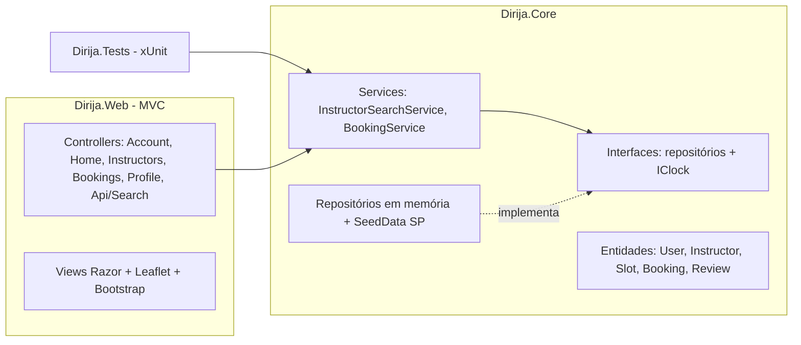
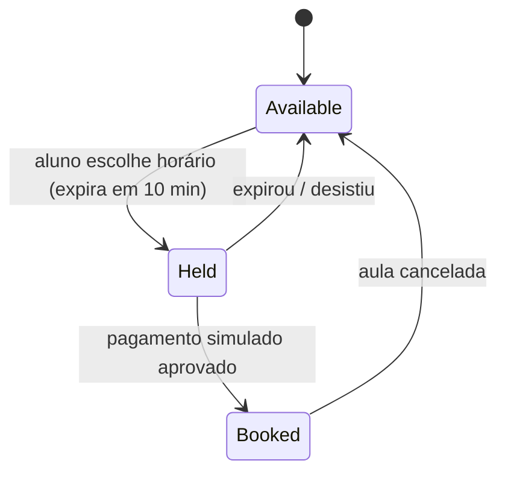
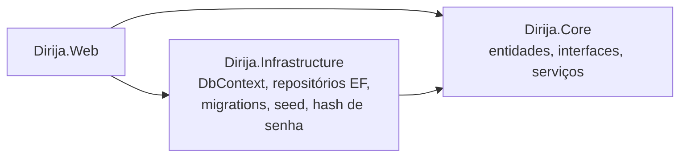

# Plano de Implementação — Dirija! (Entrega 1: fluxo do aluno)

## Problema

Entregar um MVP funcional e demonstrável do **Dirija!**, marketplace que conecta alunos tirando CNH (categorias A/B) a instrutores autônomos credenciados. Escopo desta entrega: somente o **fluxo do aluno** — encontrar instrutores próximos em São Paulo, ver perfil, reservar horário, pagar (simulado) e acompanhar aulas. Dados mockados em memória, com arquitetura pronta para trocar por EF Core + PostgreSQL depois.

## Requisitos

- ASP.NET Core MVC em **.NET 8 LTS**. Sem Redis e sem banco nesta entrega (repositórios em memória atrás de interfaces).
- Autenticação por cookie real com usuários fake: `aluno@dirija.com` / `123456` e `aluna2@dirija.com` / `123456`.
- Solução: `src/Dirija.Web` (MVC), `src/Dirija.Core` (entidades, interfaces, serviços, repositórios em memória, seed), `tests/Dirija.Tests` (xUnit).
- Código em inglês; interface em pt-BR; cultura pt-BR (R$, datas dd/MM).
- Dados mockados em bairros de São Paulo.
- Mapa: Leaflet 1.9.4 + OpenStreetMap; Bootstrap 5.3 + Bootstrap Icons 1.11.3. Layout mobile-first.
- Identidade visual dos slides: verde (`#1f9445` no cabeçalho, `#157a3b` em botões, `#22c55e` no semáforo/"!"), bege `#f3ecd8` e a logo do semáforo + "Dirija!" em serifa.
- Correções vindas do teste de protótipo:
  - pins no mapa mostrando o preço ("R$ 90") + legenda;
  - barra inferior com ícone **e** rótulo (Buscar, Minhas aulas, Perfil);
  - cards horizontais deslizáveis com foto, nome, estrelas + nº de avaliações, aulas dadas, distância e bairro;
  - "Minhas aulas" separado (Próximas / Histórico);
  - Perfil com dados, métodos de pagamento, configurações, "Sobre" e Sair.
- Anti-overbooking: um horário nunca pode ter duas reservas; bloqueio temporário de 10 min durante o checkout.
- Split simulado: taxa da plataforma de 15% configurável (`Booking:PlatformFeePercent`).
- Segurança: antiforgery em todos os POSTs; pagamento fictício (número de cartão não é armazenado). As orientações sobre o mock ficam no [Guia da demonstração](#guia-da-demonstração-dados-de-teste), não na interface.
- README curto com como rodar e contas demo.

## Contexto

- A spec técnica define as entidades Users, InstructorDetails, Slots (Available/Reserved/Confirmed/Blocked), Bookings (Pending_Payment/Confirmed/Completed/Canceled) e Payments (TotalAmount, PlatformFee, InstructorAmount). Não define take rate nem endpoints.
- Sem banco, o anti-overbooking é feito com `lock` no `BookingService`. Futuro: transação + `SELECT ... FOR UPDATE` ou exclusion constraint no PostgreSQL.
- Busca por bairro sem API de geocoding: dicionário de ~15 bairros de SP com coordenadas; distância por Haversine. Centro padrão: Av. Paulista.

## Solução proposta

Booking: `PendingPayment` → `Confirmed` → `Completed` (data passada) | `Canceled`.

## Divisão de tarefas

Dia 1: tarefas 1–5 · Dia 2: tarefas 6–9.

### Task 0 — PDF do plano
Salvar este plano em `docs/plano-implementacao.md` e gerar `docs/plano-implementacao.pdf`.

### Task 1 — Scaffold da solução e layout base
- Solução com `Dirija.Web`, `Dirija.Core` e `Dirija.Tests`, com referências entre eles.
- Cultura pt-BR; `_Layout` com header "Dirija!" e barra inferior rotulada; CSS com a paleta.
- **Testes:** `dotnet build` e `dotnet test` verdes.

### Task 2 — Domínio, seed de SP e busca
- Entidades `User`, `Instructor`, `Slot`, `Booking`, `Review`; bairros com coordenadas.
- Seed com ~12 instrutores em bairros de SP, horários nos próximos 14 dias, avaliações e aulas passadas do aluno demo.
- `InstructorSearchService`: Haversine; filtros por raio, categoria, preço máximo e nota mínima; ordenação por distância, preço ou nota.
- **Testes:** Haversine, filtros, ordenação, integridade do seed.

### Task 3 — Login com cookie e proteção de rotas
- Cookie auth, policy de fallback exigindo login, `AccountController` (Entrar/Sair), dica das contas demo.
- **Testes:** repositório de usuários; acesso sem cookie redireciona para login.

### Task 4 — Mapa de busca
- `GET /api/instrutores` com filtros (JSON).
- Busca por bairro com autocomplete, "usar minha localização", chips de filtro, pins de preço + legenda, cards deslizáveis sincronizados com os pins, estado vazio.
- **Testes:** integração do endpoint.

### Task 5 — Perfil do instrutor e agenda
- Foto, selo verificado, bio, categorias, veículo com duplo comando, ponto de encontro, minimapa com raio, avaliações.
- Agenda dos próximos 7 dias com horários livres.
- **Testes:** 200 para id válido, 404 para inválido.

### Task 6 — Reserva com bloqueio temporário
- `BookingService.HoldSlot` sob `lock`: horário livre → `Held` por 10 min, cria Booking `PendingPayment` com split.
- Checkout com resumo, timer regressivo e mensagem amigável quando o horário já foi reservado.
- **Testes:** hold OK; segundo hold falha; 50 tentativas paralelas → 1 sucesso; hold expirado libera; split correto.

### Task 7 — Pagamento simulado e confirmação
- PIX (QR fake + copia e cola) ou cartão (validação de formato; guarda só "final 1234").
- `ConfirmPayment`: valida dono e prazo → Slot `Booked`, Booking `Confirmed`.
- **Testes:** confirmação válida; hold expirado falha; usuário não paga reserva de outro.

### Task 8 — Minhas aulas e Perfil do aluno
- Abas Próximas / Histórico, badges, "Pagar agora", "Cancelar", "Avaliar aula" (recalcula a média do instrutor).
- Perfil: dados, métodos de pagamento, configurações, Sobre, Sair.
- **Testes:** cancelamento libera horário; avaliação recalcula média; não avalia aula não concluída nem duas vezes.

### Task 9 — Acabamento e demo
- Revisão em 360 px e desktop, página de erro, estados vazios, acessibilidade básica.
- Teste smoke do fluxo completo; README com roteiro de demo de 3 minutos.

## Guia da demonstração (dados de teste)

Estas informações foram retiradas da interface para a apresentação ficar limpa. **Tudo abaixo é mock** e não está pronto para produção.

**Como rodar:** `dotnet run --project src/Dirija.Web` e abrir <http://localhost:5275>. Antes de gravar, recrie o banco para começar do estado inicial: `dotnet run --project src/Dirija.Web -- --Database:ResetOnStartup=true`.

**Contas de teste** (senha `123456` para ambas):

| Conta | Uso na demo |
|---|---|
| `aluno@dirija.com` | Conta principal; já tem 1 aula confirmada e 2 no histórico (uma para avaliar). |
| `aluna2@dirija.com` | Segunda janela (anônima) para mostrar o bloqueio contra reserva duplicada. |

**Pagamento (simulado — nenhuma cobrança é feita):**
- PIX: o QR Code e o código "copia e cola" são ilustrativos; basta clicar em **Já paguei**.
- Cartão de teste: `4111 1111 1111 1111`, qualquer validade futura (ex.: `12/30`), CVV `123`. Apenas os 4 últimos dígitos são guardados ("Cartão final 1111").

**O que é simulado:**
- Usuários, instrutores, horários e avaliações são fictícios. Desde a Entrega 1.1 ficam num banco SQLite (`src/Dirija.Web/App_Data/dirija.db`) e **sobrevivem ao reinício**. Para voltar ao estado inicial antes de gravar a demo, pare o app e apague o `dirija.db`, ou rode `dotnet run --project src/Dirija.Web -- --Database:ResetOnStartup=true`.
- As senhas das contas demo são guardadas com hash (PBKDF2), mas não existe cadastro nem recuperação de senha.
- As credenciais Detran exibidas são números inventados; "Credencial verificada" não consulta nenhum órgão.
- Notificações (lembrete, WhatsApp, e-mail) aparecem no Perfil, mas não são enviadas.
- O mapa e o Bootstrap vêm de CDN: a demo precisa de internet.

**Roteiro sugerido (3 min):**
1. Entrar com `aluno@dirija.com`.
2. Buscar "Moema", filtrar Categoria B e "Até R$ 100"; clicar num pin para destacar o card.
3. Abrir o perfil do instrutor (credencial, veículo, ponto de encontro, área de atendimento, avaliações).
4. Escolher um horário → checkout com timer de 10 min.
5. Em janela anônima, entrar com `aluna2@dirija.com` e tentar o mesmo horário: é recusado.
6. Pagar com PIX ou cartão de teste → "Aula confirmada".
7. Minhas aulas: ver em Próximas, cancelar uma, avaliar uma do Histórico.
8. Perfil: dados, pagamentos, configurações, Sobre e Sair.

## Entrega 1.1 — Persistência com SQLite (EF Core)

Os dados em memória foram substituídos por um banco SQLite, sem mudar o fluxo do aluno.

**Decisões:**
- Projeto novo `Dirija.Infrastructure`: o Core não depende do EF; a troca de banco fica isolada nesse projeto.
- Repositórios e serviços assíncronos e *scoped* (um `DbContext` por requisição).
- **Anti-overbooking:** controle de concorrência otimista. `Slot` e `Booking` têm uma coluna `Version`; o `UPDATE` só acontece se a versão não mudou. Se dois alunos reservam o mesmo horário, o segundo recebe "horário indisponível". Testado com 50 reservas simultâneas num arquivo SQLite real (1 sucesso).
- **Datas em UTC** no banco, exibidas no horário de São Paulo (`SaoPauloTime`). As regras de agenda (08h–17h, sábado até 12h) usam o horário local.
- **Senhas com hash** (`PasswordHasher` do ASP.NET Core Identity).
- **Busca geográfica:** pré-filtro por "quadrado" de latitude/longitude no banco (índice) + distância exata (Haversine), filtro de preço e ordenação em C#.
- **Inicialização:** aplica migrations; na primeira execução grava o seed; nas próximas só completa os horários dos próximos 14 dias. `Database:ResetOnStartup=true` recria o banco.

**Próximo passo — PostgreSQL:**
1. Trocar o pacote `Microsoft.EntityFrameworkCore.Sqlite` por `Npgsql.EntityFrameworkCore.PostgreSQL` e `UseSqlite` por `UseNpgsql` (`DependencyInjection.cs`).
2. Apagar `Persistence/Migrations` e gerar a migration `Inicial` de novo.
3. Ajustar a connection string; o seed roda de novo no banco vazio.
4. Opcional: reforçar o anti-overbooking com `SELECT ... FOR UPDATE` ou *exclusion constraint*, e trocar o pré-filtro por PostGIS (`geography(Point,4326)` + índice GiST + `ST_DWithin`).

## Próximas entregas (fora do escopo)

- PostgreSQL/PostGIS e cadastro de usuários.
- Painel do instrutor (agenda, preço, área de atendimento, documentos).
- Painel do administrador (aprovação de credenciais, disputas, métricas).
- Gateway de pagamento real com split e notificações.
